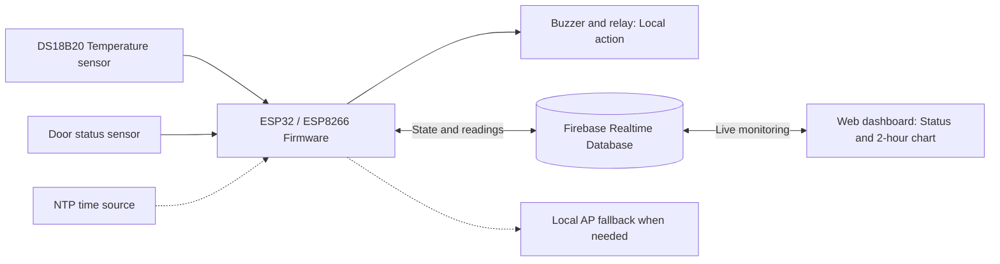

# Cold-Chain Monitoring — IoT Engineering Case Study

**ESP32 / ESP8266 · DS18B20 · Firebase Realtime Database · Embedded Monitoring**

> **Project status: Functional prototype.** This is an engineering case study, not a claim of medical-device certification, a validated vaccine storage installation, or a commercial deployment.

## Overview

A connected monitoring prototype for temperature-sensitive storage. It brings together embedded sensing, local alerts, remote state reporting, and a browser-based monitoring interface.

The prototype addresses a practical problem: temperature deviations or an open storage door can go unnoticed between manual checks. Connected sensing can improve visibility, while local alarms can remain useful when cloud access is unreliable.

## Prototype functionality

- Temperature readings from a **DS18B20** digital sensor.
- Door-status sensing.
- Local alarm/actuation logic using a **buzzer** and **relay**.
- Remote device state communicated through **Firebase Realtime Database**.
- Browser-based monitoring, including a **two-hour temperature chart**.
- **NTP** time synchronisation when network access is available.
- Configurable operating/override mode.
- **Access-point fallback** for local configuration or access if normal connectivity fails.

These are features reported from prototype development; exact field performance, uptime, sensor accuracy and failure-recovery characteristics have not been independently validated here.

## System architecture

The following is a **conceptual representation**, not an electrical wiring diagram or a reproduction of the original source code.

## Engineering focus

| Area | Challenge / approach |
| --- | --- |
| Embedded sensing | Sampling temperature and door status reliably |
| Device-to-cloud communication | Keeping remote state consistent with device readings |
| Local response | Using buzzer/relay logic without depending entirely on a web dashboard |
| Connectivity | Handling unavailable Wi-Fi and providing a local AP fallback |
| Observability | Presenting status and a short historical temperature view |
| Device time | Using NTP where connectivity permits |

## Read more

- [Architecture and data flow](docs/ARCHITECTURE.md)
- [Monitoring, alarms and failure modes](docs/MONITORING-AND-FAILURE-MODES.md)
- [Prototype validation and limitations](docs/VALIDATION.md)
- [Publication and licensing note](LICENSE-NOTE.md)

## Scope and disclosure

This public repository contains **documentation only**. It does not include proprietary application code, device credentials, live Firebase URLs, real patient or client records, or claims of regulatory approval. Diagrams are reconstructed descriptions; they are not actual hardware photographs.

## Author

**Justice Zhou** — Software Engineer and Founder, Net IT Solutions (Pvt) Ltd

[Personal GitHub](https://github.com/JUZHOU88) · [Company GitHub](https://github.com/NETITSOLUTIONS)

*Embedded systems, backend integration and practical software engineering.*
